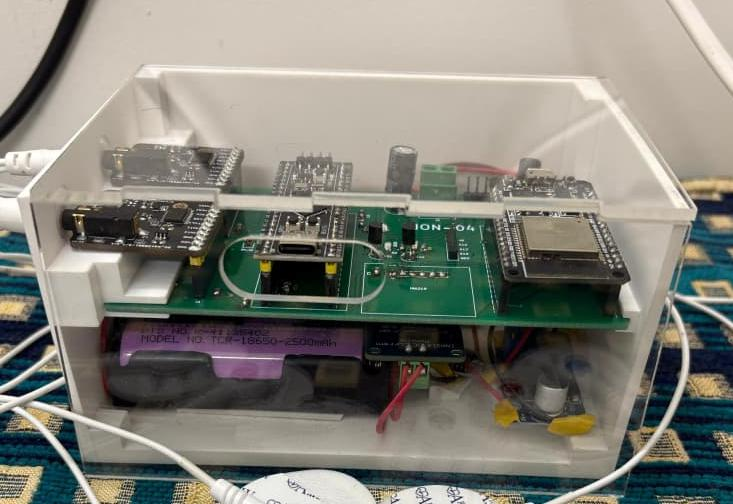
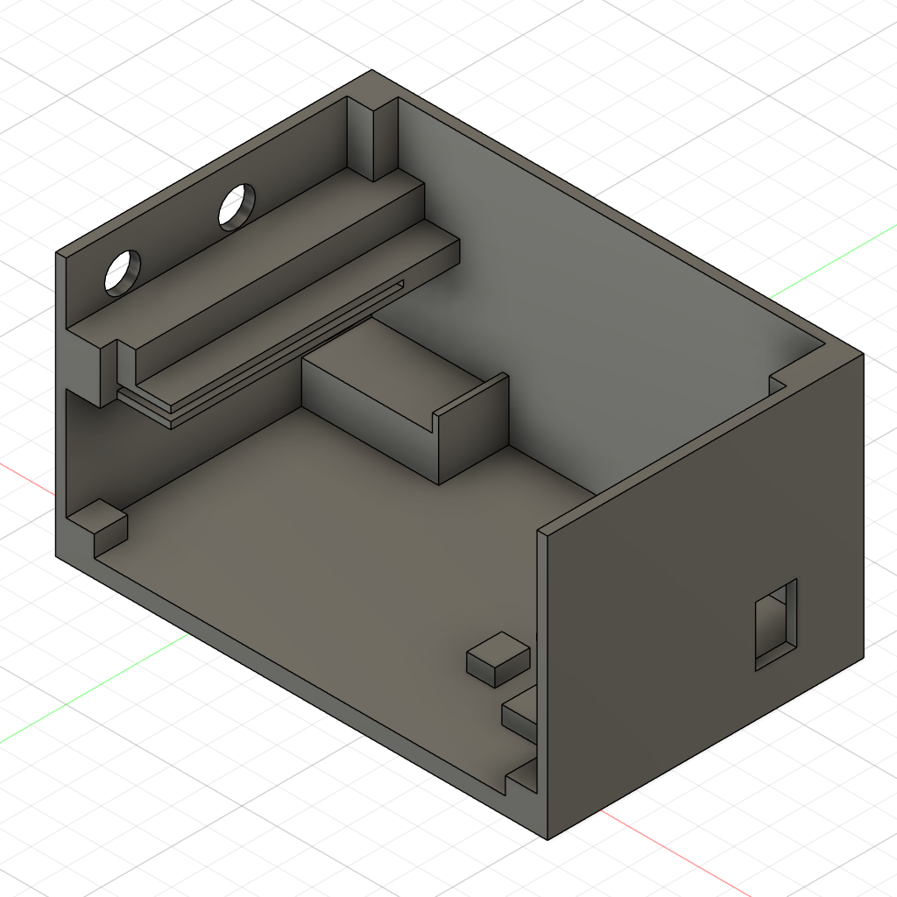
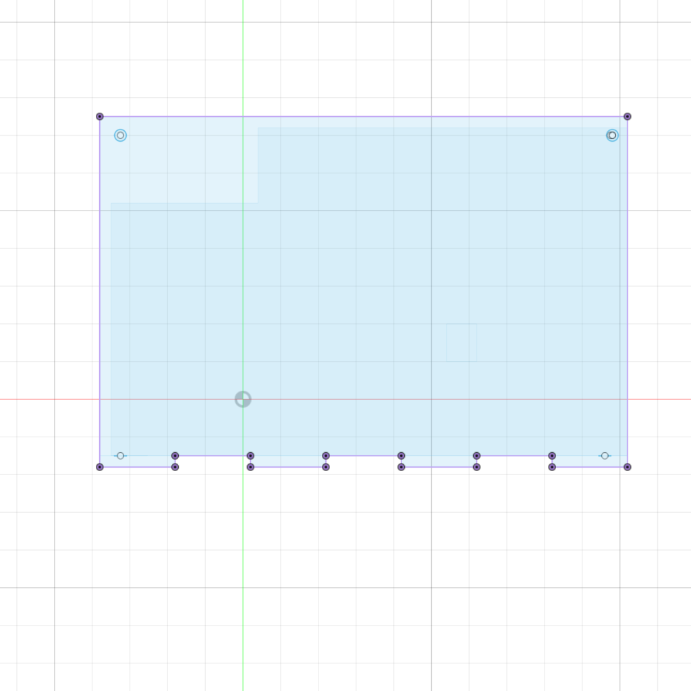
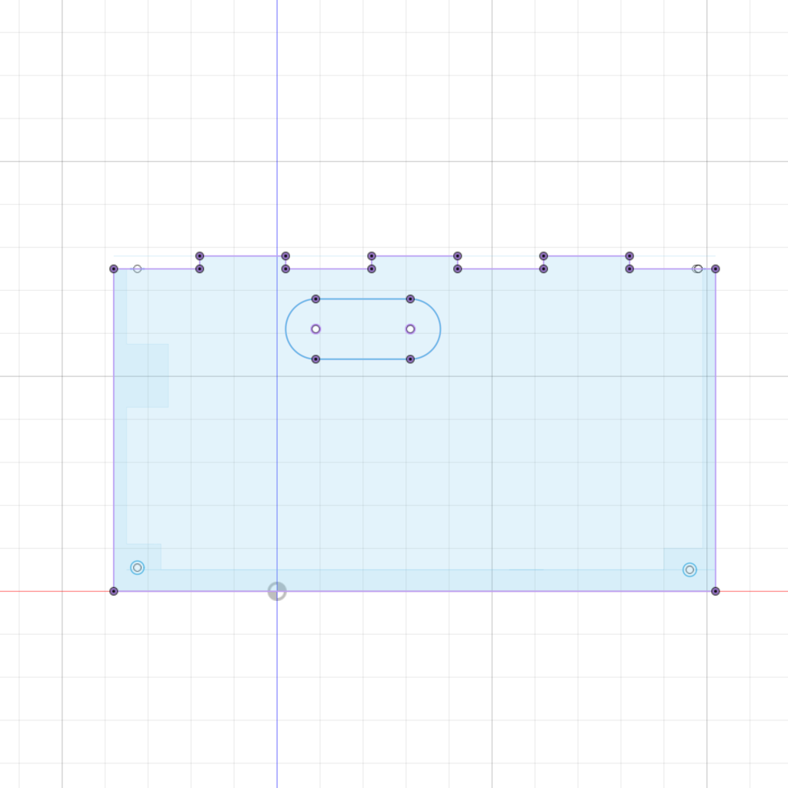

# Device Enclosure — 3D Model & Laser-Cut Assembly

## Overview

The device enclosure gives the hardware a compact, clean form factor while keeping all functional access points reachable. It is a hybrid assembly combining a 3D printed body with laser-cut acrylic panels.

---

## Components

### 1. 3D Printed Encasing

The main structural body of the enclosure. It features a shelf-like internal structure — the PCB sits on the upper shelf, while the battery circuit is housed in the compartment below it.

**Access points on the encasing:**

| Port / Feature | Purpose |
|:---------------|:--------|
| Stereo jack opening | Insert ECG/Bio-Z electrodes |
| USB Type-C opening | Battery charging |
| Toggle switch cutout | Power on/off |

---

### 2. Laser-Cut Top Panel

Forms the top face of the enclosure box. Made from **transparent acrylic**, allowing the internal components to be visible from above.

---

### 3. Laser-Cut Front Panel

Forms the front face of the enclosure. It has a cutout for a **USB Type-C connector** that connects directly to the STM32 BlackPill.

This wired connection serves two purposes:
- **Wired data transfer** — retrieves waveforms and other recorded data with lower latency compared to the Wi-Fi/UDP wireless path.
- **Device power** — the board can also be powered through this connection.

---

## Design Files

| File | Description |
|:-----|:------------|
| `elec_box.stl` | 3D printable encasing body |
| `top_acrylic_plate.dxf` | Laser-cut top acrylic panel |
| `front_acrylic_plate.dxf` | Laser-cut front panel with USB-C cutout |

> Update the filenames above to match your actual exported files.

---

## Fabrication Notes

**3D Printing**
- Recommended material: PLA or PETG for structural rigidity.
- Print with sufficient wall thickness (≥ 2 shells) and infill (≥ 20%) around the shelf region for mechanical strength.

**Laser Cutting**
- Material: Transparent acrylic (recommended thickness: 3 mm).
- Ensure the USB Type-C cutout on the front panel is dimensioned to match your specific connector or cable head clearance.