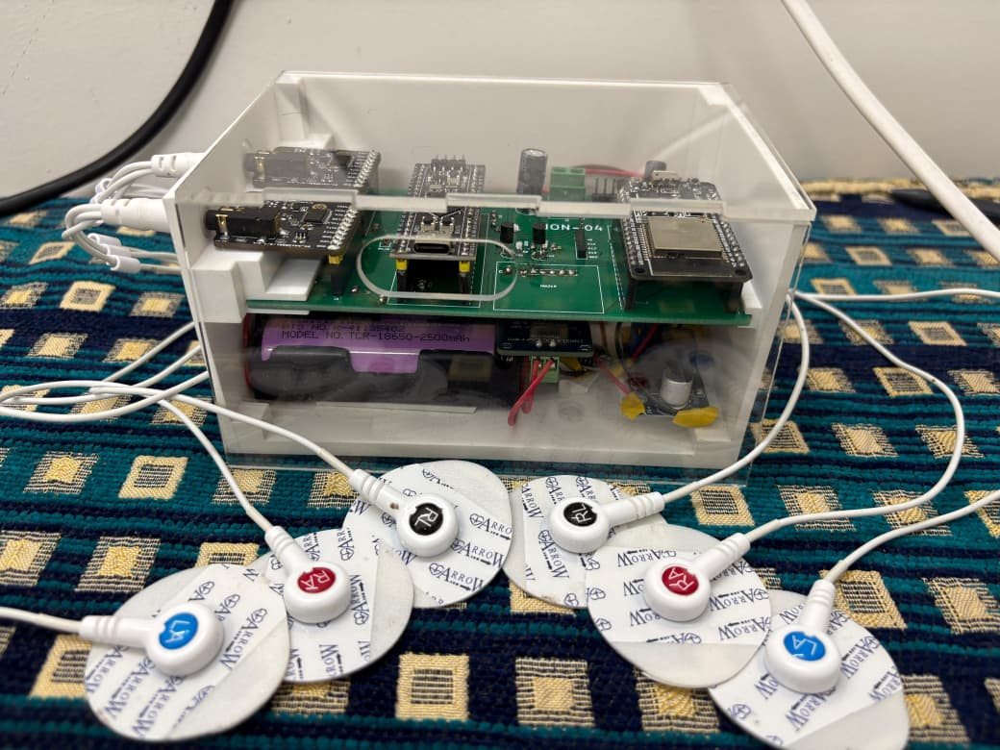
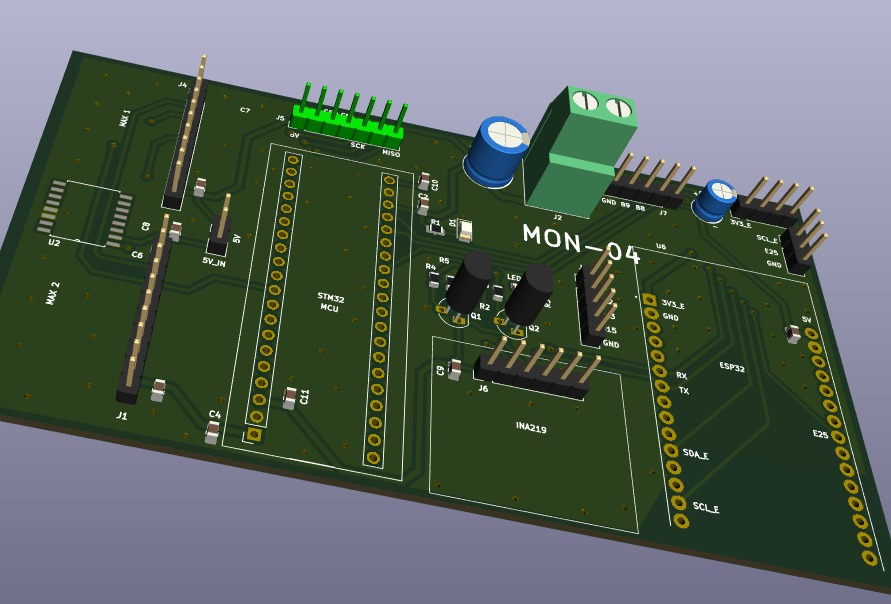
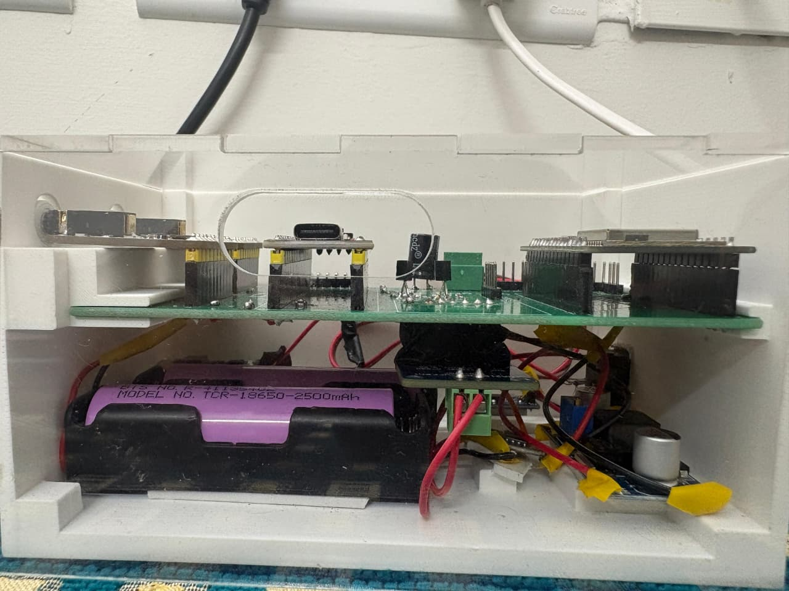
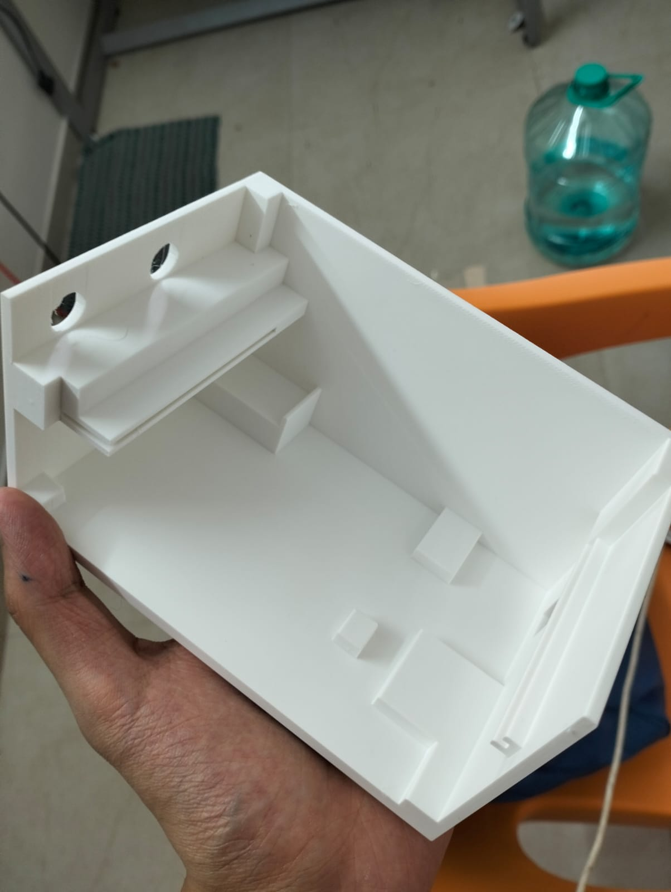

# IM-PULSE — Cuffless Blood Pressure & Cardiac Monitor

**🏆 Top-10 finalist, EDL 2026, IIT Bombay**

<p align="center">
  
</p>

IM-PULSE is a compact, portable biomedical monitor built in the Electronic Device Lab (EDL) course at IIT Bombay. It acquires ECG and two arterial pulse waveforms (APW, from bioimpedance/IPG) through six electrodes on the chest and foot. It detects ECG R-peaks and APW feet on board, measures **pulse transit time (PTT)** and **pulse wave velocity** (4–10 m/s), and estimates **blood pressure without a cuff** using an XGBoost model. Data streams wirelessly to a laptop, which shows a live PyQt6 dashboard and serves the vitals to any browser through a Flask web server.

The aim is a convenient alternative to bulky inflatable-cuff BP monitors and conventional ECG / Bio-Z instruments, for frequent cardiac monitoring where such equipment is unavailable or unaffordable.

## System Overview

```
 6 electrodes (chest, foot, abdomen ref.)
        │
 2 × MAX30001 AFE  ── ECG + BioZ @ 128 Hz ──┐
                                            ▼  SPI
 INA219 power monitor ── I2C ──►  STM32F411 Black Pill
                                   • Pan-Tompkins R-peak detection (ECG)
                                   • APW foot detection (proximal: ECG-triggered cubic fit,
                                     distal: morphological V-shape detector)
                                   • 36-byte packet every 8 ms
                                            │  UART 57600
                                            ▼
                                   ESP32  ── UDP broadcast, port 12345 (Wi-Fi)
                                            │
                                            ▼
                     Laptop: display.py (PyQt6)                webserver.py (Flask + ngrok)
                     • PTT, PWV, heart rate, HRV       ──►     • browser dashboard on LAN
                     • ECG morphology (QRS, PR, QTc)   JSON    or the internet
                     • XGBoost BP estimate
```

| | |
|---|---|
| Acquisition | 2 × MAX30001 (ECG + bioimpedance), 128 Hz per channel |
| Processing MCU | STM32F411CEU6 (Cortex-M4F, 100 MHz) |
| Wireless | ESP32, UART → UDP over Wi-Fi |
| Power | 2 × 18650 Li-ion with BMS, INA219 telemetry |
| Hardware | Custom two-layer PCB (KiCad), 3D-printed enclosure with acrylic panels |
| Host software | Python: PyQt6 + pyqtgraph GUI, Flask dashboard, XGBoost BP model |

## Repository Layout

| Path | Contents |
|---|---|
| [`src/stm32_blackpill/`](src/stm32_blackpill) | Acquisition and on-board DSP firmware (Arduino / STM32duino) |
| [`src/esp32_bridge/`](src/esp32_bridge) | UART-to-UDP Wi-Fi bridge firmware |
| [`src/host_app/`](src/host_app) | Desktop GUI (`display.py`), web dashboard (`webserver.py`), trained BP model |
| [`pcb/`](pcb) | KiCad project for the device PCB, footprints, layer prints, BMS build photos |
| [`3d_models/`](3d_models) | Enclosure STL and laser-cut acrylic panel DXFs |
| [`others/`](others) | [User manual](others/USER_MANUAL.md), build photos, MATLAB simulations, BMS docs, write-ups |
| [`reports/`](reports) | Milestone reports M0–M4 |
| [`bom.xls`](bom.xls) | Bill of materials |

Every folder has its own README with details. Each firmware/software folder also has a `SETUP.md` with flashing or run instructions.

## Quick Start

1. **STM32** — flash `src/stm32_blackpill/stm32_blackpill.ino` with the STM32duino core ([setup](src/stm32_blackpill/SETUP.md)).
2. **ESP32** — put your Wi-Fi SSID and password in `src/esp32_bridge/esp32_bridge.ino`, then flash it ([setup](src/esp32_bridge/SETUP.md)).
3. **Laptop** — join the same network, then run:
   ```sh
   cd src/host_app
   pip install -r requirements.txt
   python display.py      # live GUI + signal processing
   python webserver.py    # in a second terminal: browser dashboard on port 5000
   ```
   See [`src/host_app/SETUP.md`](src/host_app/SETUP.md) for virtual-environment and ngrok setup, and the [user manual](others/USER_MANUAL.md) for electrode placement.

## Build Photos

| PCB | Assembled device | Enclosure |
|---|---|---|
|  |  |  |

## Team

IM-PULSE (group MON-04): Yashvardhan Khandegar, Sudhindra Sahoo, Jahnvi Sharma, Vinay Hariharan, Krunal Vaghela.

---

# Reflections, Challenges & Future Work

### Project Status Summary

| Specification / Requirement | Status | Remarks / Justification |
|:----------------------------|:------:|:------------------------|
| 4-electrodes only, two on each wrist | ⚠️ Incomplete | Wrist APW unviable — instead we used 6 electrodes (chest (2) + foot (2) + abdomen reference (2)) |
| Compact portable table-top unit (bio-signal acquisition, processing & wireless) | ✅ Complete | |
| Onboard ECG R-peak & APW foot detection on STM32 | ✅ Complete | |
| Plot ECG + proximal & distal APW, verify reliability | 🔶 Partial | Chest ECG & APW reliable; foot APW less regular due to lower SNR — heart rate cross-verified with clinical device |
| Obtain Pulse Wave Velocity in typical range (4–10 m/s) | ✅ Complete | |
| Derive other health parameters from PTT and cross-verify them | 🔶 Partial | We focused on blood pressure as research has shown negative PTT–BP correlation; model trained on single subject (data limitation) |

---

### Challenges & How We Overcame Them

#### Dual-Purpose BioZ (Respiration + APW for PTT)

**Problem:** The MAX30001's BioZ channel conflates respiration and blood-related IPG signals. Respiration-focused acquisition introduced a DC offset and saturation, distorting the APW signal needed for PTT computation.

**Solution:** We reconfigured the channel for blood IPG (APW) by removing respiration-centric filtering, applying a band-pass filter (~0.8–5 Hz), and syncing the APW with ECG R-peaks to correctly compute PTT.

---

#### Electrode Placement & Signal Integrity

**Problem:** Accurate proximal–distal APW measurement required very precise electrode placement, and signals were frequently distorted by environmental interference from nearby charged sources.

**Solution:** After extensive experimentation, we finalized electrode positions over the chest (proximal) and left foot (distal) arteries to capture stable APW. Interference was eliminated by grounding nearby charged objects in the measurement environment.

---

#### PTT–BP Modeling with a Custom Dataset

**Problem:** No reliable publicly available dataset exists for heart-to-foot PTT vs blood pressure correlation. Our raw measurements were noisy and unstructured, making it difficult to train a meaningful model.

**Solution:** We collected approximately 200 samples using reference blood pressure measurements alongside our PTT readings, cleaned and processed the raw data, and trained a regression model to learn the PTT–BP mapping and extract meaningful patterns.

---

#### STM32 Chip Mismatch (F411CE vs F401CE)

**Problem:** The BlackPill boards purchased were labelled STM32F411CE, but many units in the market are actually equipped with an STM32F401CE chip. This silent mismatch caused repeated code upload failures and cost significant debugging time before the root cause was identified.

**What We Learned:** Always verify the actual chip ID using STM32CubeProgrammer before beginning development. Physical markings on a board cannot always be trusted, especially with generic suppliers.

---

### Key Takeaways

**Technical:**
- Bio-signal acquisition requires careful analog front-end tuning — default configurations are rarely sufficient for multi-purpose sensors like the MAX30001.
- Electrode placement has a profound impact on signal quality; this is as much a physiological problem as an electronics one.
- Building a custom dataset from scratch is time-consuming but necessary when the target measurement (heart-to-foot PTT) does not have existing benchmarks.
- Hardware debugging (chip mismatches, board variants) can consume a disproportionate amount of time — always validate components early.

**Team & Process:**
- A modular PCB and software architecture paid off: when individual components failed or needed replacement, the rest of the system remained unaffected.
- Separating the signal processing pipeline from the hardware layer early allowed the software team to develop and test algorithms in parallel with PCB bring-up.
- Time lost on hardware issues compressed the software iteration cycles — future projects should budget extra time for hardware validation in the first two weeks.

---

## Incomplete Features & Future Work

### Features Not Completed Within the Course Timeline

- **Wrist-based APW measurement:** The original specification required only 4 electrodes placed on the wrists. Wrist APW turned out to be physiologically unviable for our sensing configuration — the signal was too weak and inconsistent for reliable PTT computation. This remains unresolved.
- **Multi-subject PTT–BP model:** The trained blood pressure model was built on data from a single subject due to time constraints. A generalised model requires a larger and more diverse dataset, which was not feasible within the semester.
- **Full cross-verification of derived health parameters:** While blood pressure estimation via PTT was partially achieved, other health parameters derivable from PTT (e.g., arterial stiffness index) were not implemented or verified.

---

### Concrete Future Work

**1. Expand the PTT–BP dataset and improve the model**
The current model is trained on a single subject (~200 samples), which limits its generalisability. Future work would involve collecting data across multiple subjects with varying age, fitness levels, and blood pressure ranges, and retraining the model. A more robust architecture (e.g., a subject-adaptive or personalised calibration model) could significantly improve accuracy.

**2. Improve foot APW signal quality with better analog filtering**
The foot APW signal had lower SNR compared to the chest signal. This could be addressed by adding a programmable gain stage or a narrower band-pass filter specifically tuned for the distal IPG signal, implemented either in hardware (op-amp filter stage on PCB) or through tighter DSP filtering on the STM32.

**3. Investigate wrist-based electrode configuration**
The wrist APW failure could be revisited by exploring different electrode configurations (e.g., radial artery targeting) or switching to PPG-based sensing at the wrist as a complementary approach for PTT. This would bring the device closer to the original wearable specification.

**4. Reduce wireless latency for real-time monitoring**
The current UDP-over-WiFi transmission introduces latency that makes real-time waveform monitoring less smooth. Switching to a lower-latency protocol (e.g., BLE with a custom GATT profile) or implementing a lightweight compression scheme before transmission could improve the live display experience without requiring a wired connection.

**5. Onboard blood pressure display**
Currently, BP estimation requires post-processing on a connected laptop. Integrating a small OLED display on the device and running the trained model directly on the ESP32 (after model quantisation) would make the device fully self-contained and usable without a computer.