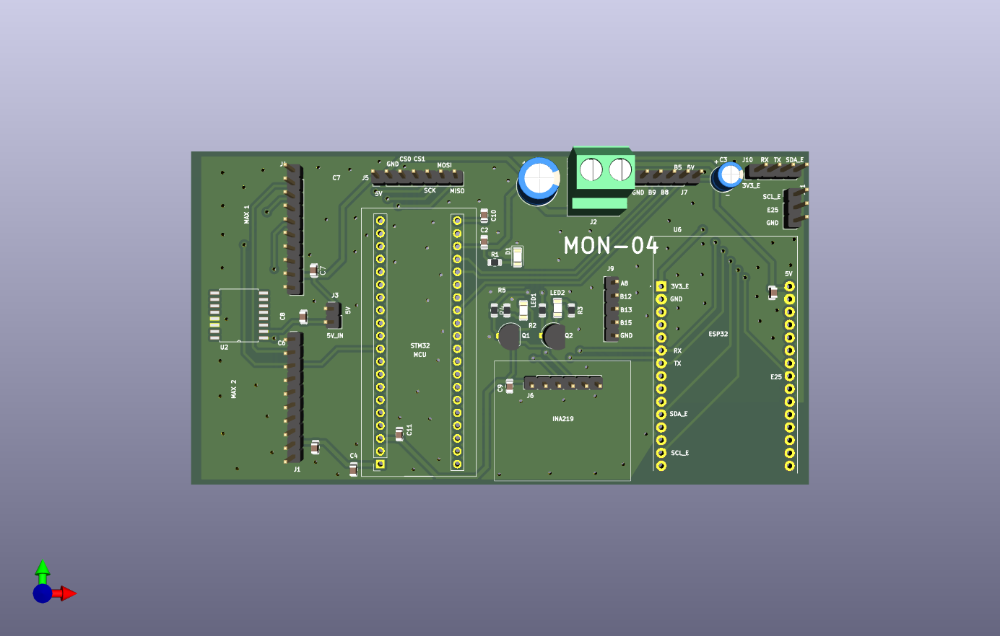
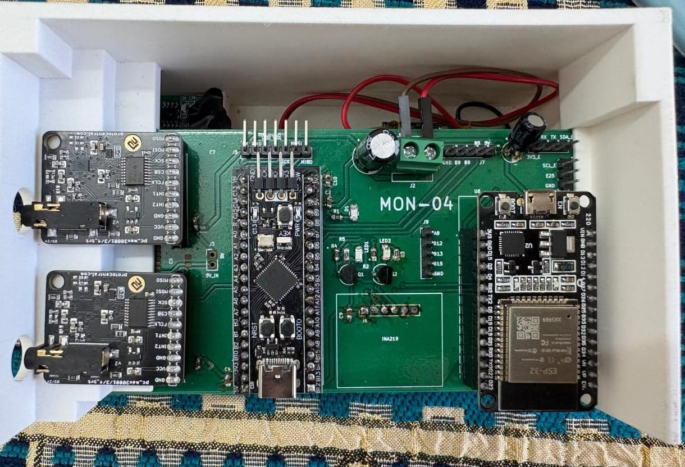
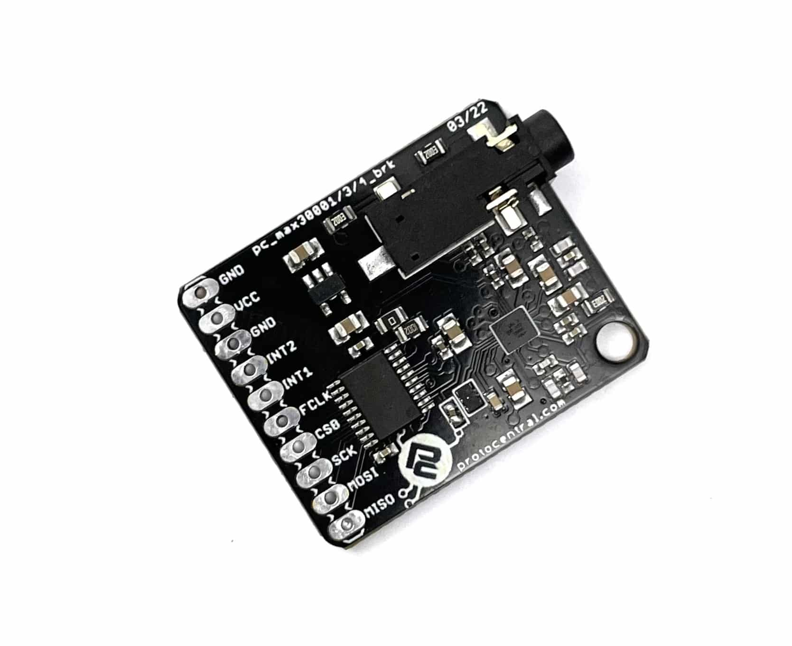
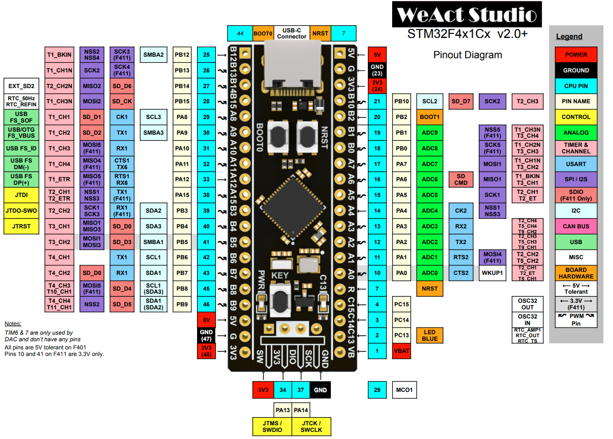
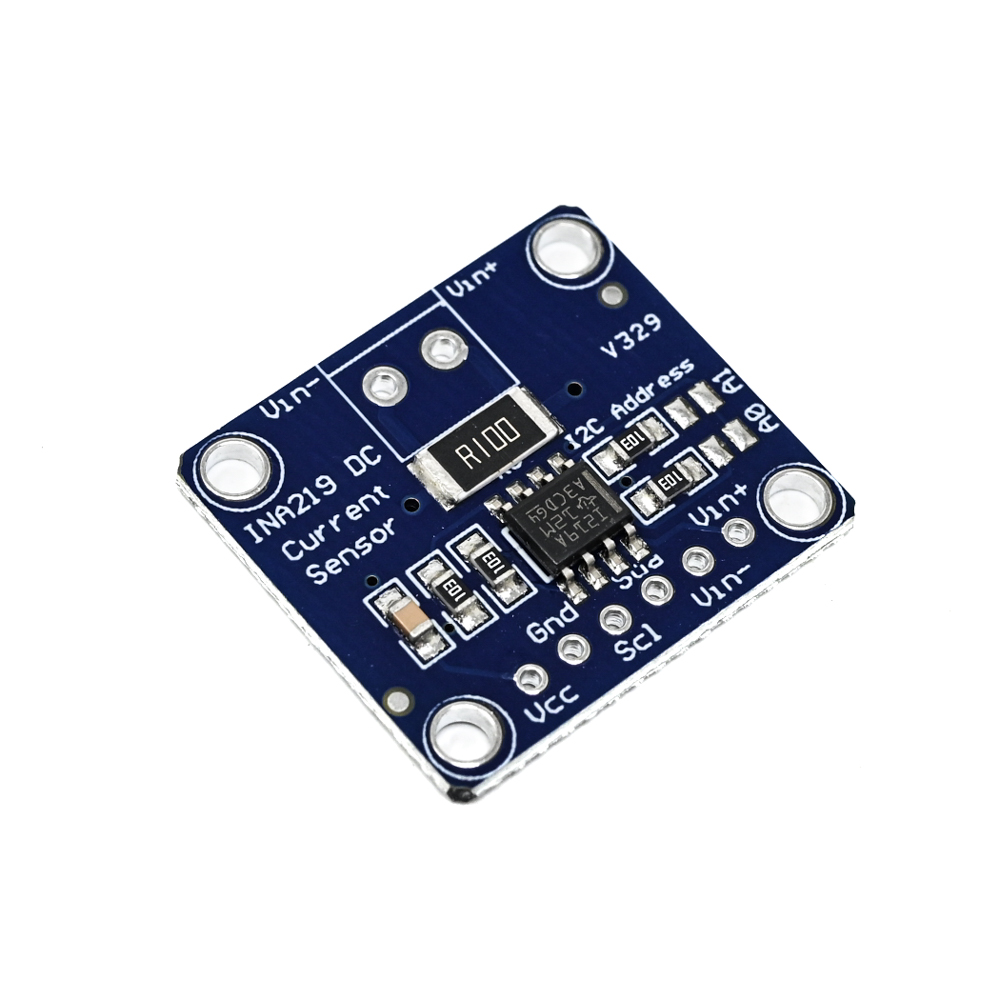
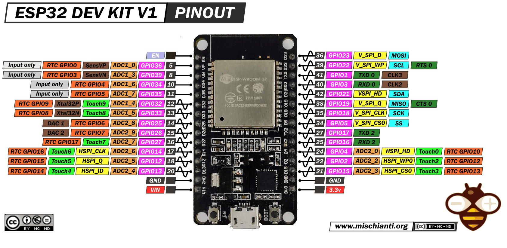

# PCB Design 

## Overview

The primary purpose of this PCB is to provide an organized and compact physical realization of the circuit. It is basically a Bio-Signal Acquisition Board. Most components are breakout/evaluation boards that are directly fixed onto the PCB using female header pins, with the PCB establishing the required electrical connections between them.

<!-- Board photo -->


<!-- Board photo -->


---

## Features & Design Choices

### Two-Layer PCB with Ground Planes
SMD components are placed on the top layer, with a ground plane on both the top and bottom layers. Using ground planes on both sides helps shield signals from noise and provides a stable return path. Placing all components on the top layer simplifies the assembly process for both SMD and Through-Hole components. The continuous ground plane on the bottom layer also aids in heat dissipation due to the larger copper area.

### Modular PCB Design
Since the main goal of this project is building the software stack for bio-signal processing, the PCB is designed to act as an integration unit for power and signal connections between different modules. This modular setup keeps the focus on algorithms and makes it easy to replace individual parts if they are damaged.

### Indicator LEDs & Breakout Pins for Debugging
Built-in test points in the form of indicator LEDs and breakout pins make it easier to monitor power and signal lines, and to troubleshoot issues using an oscilloscope or multimeter. 
- One red-colored POWER LED
- Two yellow-colored LEDs to indicate which of the MAX30001 has been selected
- There are a few pins broken-out from the STM32 and the ESP32 such as general GPIO, SPI/UART lines for expanding functionality as well as debugging.  


### Power Stability
The PCB requires a stable & regulated 5V input at its main screw terminal. The STM32 has onboard 5V to 3V3 regulator, which then distributes a stable 3V3 voltage to other components. Decoupling capacitors are placed at the power inputs and outputs of each module to filter out electrical noise and maintain stable voltage levels.

---

## Components & Signal Flow

### Bio-Signal Acquisition — MAX30001 (×2)
Two **Protocentral MAX30001** breakout boards are used for collecting:
- **ECG** (Electrocardiogram) signals
- **Bio-Z** (Bioimpedance) signals

Both boards interface with the STM32 via **SPI**.


### Main MCU — STM32 BlackPill
The STM32 serves as the central processing unit of the system. It:
- Receives raw bio-signal data from both MAX30001 boards over SPI
- Runs on-board DSP algorithms for **ECG R-peak detection** and **APW (Arterial Pulse Wave) foot detection**
- Communicates with the INA219 over **I2C**
- Transmits processed data to the ESP32 over **UART (TX/RX)**


### Power Monitoring — INA219
The **INA219** current/power sensor is connected to the STM32 via **I2C**. It provides real-time data on:
- Battery voltage
- Current draw


### Wireless Communication — ESP32
The **ESP32** is connected to the STM32 via **UART**. It:
- Receives data packets containing waveform data, detected special points (R-peaks, APW feet), and INA219 readings
- Generates a **Wi-Fi access point** for wireless connectivity
- Transmits data to connected clients (e.g., laptops) using the **UDP** protocol

---

## System Architecture

```
┌─────────────────┐     SPI      ┌────────────────────┐
│  MAX30001 #1    │─────────────▶│                    │
│  (ECG / Bio-Z)  │              │   STM32 BlackPill  │──── I2C ────▶ INA219
└─────────────────┘              │   (DSP + Control)  │
                                 │                    │──── UART ───▶ ESP32 ──▶ WiFi (UDP)
┌─────────────────┐     SPI      │                    │
│  MAX30001 #2    │─────────────▶│                    │
│  (ECG / Bio-Z)  │              └────────────────────┘
└─────────────────┘
```

---

## Communication Interfaces Summary

| Interface | Between | Purpose |
|-----------|---------|---------|
| SPI | STM32 ↔ MAX30001 (×2) | Bio-signal data acquisition |
| I2C | STM32 ↔ INA219 | Battery voltage & current monitoring |
| UART | STM32 ↔ ESP32 | Processed data transfer |
| UDP (Wi-Fi) | ESP32 ↔ Client Device | Wireless data streaming |

## Pin Connections
 
### MAX30001 Board 1 → STM32 (SPI)
 
| MAX30001 Pin | STM32 Pin | Notes |
|:-------------|:----------|:------|
| GND | GND | |
| VCC | 3V3 | |
| GND | GND | |
| INT2 | — | Not Connected |
| INT1 | PB10 | Interrupt line |
| FCLK | — | Not Connected (external CLK not used) |
| CS0 | PB0 | Chip Select |
| SCK | PA5 | SPI1 Clock |
| MOSI | PA7 | SPI1 MOSI |
| MISO | PA6 | SPI1 MISO |
 
### MAX30001 Board 2 → STM32 (SPI)
 
| MAX30001 Pin | STM32 Pin | Notes |
|:-------------|:----------|:------|
| GND | GND | |
| VCC | 3V3 | |
| GND | GND | |
| INT2 | — | Not Connected |
| INT1 | PA1 | Interrupt line |
| FCLK | — | Not Connected (external CLK not used) |
| CS0 | PA0 | Chip Select |
| SCK | PA5 | SPI1 Clock (shared) |
| MOSI | PA7 | SPI1 MOSI (shared) |
| MISO | PA6 | SPI1 MISO (shared) |
 
> **Note:** Both MAX30001 boards share the same SPI bus (SCK, MOSI, MISO). They are differentiated by their individual Chip Select (CS0) pins — PB0 and PA0 respectively.
 
### INA219 → STM32 (I2C)
 
| INA219 Pin | STM32 / Connection | Notes |
|:-----------|:-------------------|:------|
| VCC | 3V3 | |
| GND | GND | |
| SCL | PB6 | I2C1 Clock |
| SDA | PB7 | I2C1 Data |
| Vin+ | Battery (+) terminal | High-side current sensing |
| Vin− | Switch output | Connected via the power switch |
 
### ESP32 → STM32 (UART)
 
| ESP32 Pin | STM32 Pin | Notes |
|:----------|:----------|:------|
| TX2 | PA10 (RX1) | ESP32 transmits → STM32 receives |
| RX2 | PA9 (TX1) | STM32 transmits → ESP32 receives |
 
---
 
## Known Issues & Gotchas
 
### ⚠️ STM32F411CE vs STM32F401CE Chip Mismatch
 
The STM32 BlackPill boards purchased were labelled as **STM32F411CE**, however many units sold in the market are actually equipped with an **STM32F401CE** chip. This mismatch is not visible externally and caused significant time loss during development when code uploads were failing unexpectedly.
 
**Root cause:** Counterfeit or mislabelled boards — the chip inscription on the package does not always match the actual silicon inside.
 
**How to detect:** Open **STM32CubeProgrammer**, connect via ST-Link, and check the **Device ID** reported by the programmer. This will reveal the actual chip variant regardless of what is printed on the board.
 
**Fix:** Once the correct chip is identified (e.g., `STM32F401CE`), select the matching target in STM32CubeIDE / STM32CubeMX and re-generate the project configuration.
 
---
 
## Component Links
 
| Component | Supplier | Link |
|:----------|:---------|:-----|
| Protocentral MAX30001 ECG & Bio-Z Breakout (×2) | Protocentral | [protocentral.com](https://protocentral.com/product/protocentral-max30001/) |
| STM32F411CEU6 BlackPill (WeAct Studio) | Robu.in | [robu.in](https://robu.in/product/weact-studio-blackpill-stm32f411ceu6-f411-25m-hse-core-learning-board-micropython-development/) |
| STM32F411CEU6 Minimum System Board | Robu.in | [robu.in](https://robu.in/product/stm32f411ceu6-minimum-system-board-microcomputer-stm32-arm-core-board/) |
| INA219 Current/Power Monitor (CJMCU-219) | Robu.in | [robu.in](https://robu.in/product/cjmcu-219-ina219-i2c-interface-no-drift-bi-directional-current-power-monitoring-sensor-module/) |
| ESP32 WROOM-32 Development Board | Robu.in | [robu.in](https://robu.in/product/esp32-38pin-development-board-wifibluetooth-ultra-low-power-consumption-dual-core/) |
| ST-Link V2 Programmer (for flashing STM32) | Robu.in | [robu.in](https://robu.in/product/st-link-v2-programmer-for-stm8-and-stm32/) |
 
> **Note:** The MAX30001 is a Protocentral product and is not available on Robu.in. Purchase directly from [protocentral.com](https://protocentral.com/product/protocentral-max30001/).
 
 